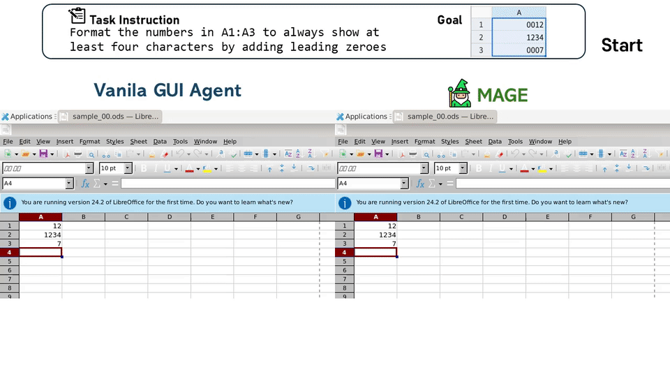
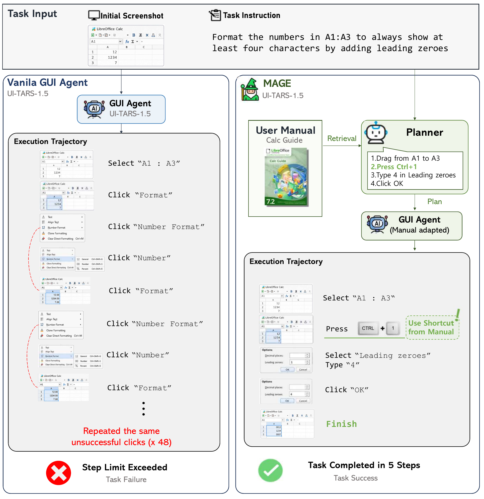

# MAGE

### Manual-augmented computer use AGent Execution and learning

**Adapting GUI agents to unfamiliar software with user manuals.**

<p>
  <a href="LICENSE"></a>
  
  
</p>

<p>
  <a href="README.md#demo" data-toggle="anchor">🎬 Demo</a> ·
  <a href="README.md#features" data-toggle="anchor">✨ Features</a> ·
  <a href="README.md#get-started" data-toggle="anchor">🚀 Get Started</a> ·
  <a href="README.md#repository-layout" data-toggle="anchor">📂 Repository Layout</a> ·
  <a href="README.md#citation" data-toggle="anchor">📖 Citation</a> ·
  <a href="README.md#license" data-toggle="anchor">📄 License</a>
</p>

MAGE retrieves task-relevant manual instructions for computer use agent planning and converts the same manuals into executable task-plan pairs for policy training, without human-authored demonstrations.

See the paper (arXiv preprint, link coming soon) for the method, experimental setup, and results.

<h2 id="demo">🎬 Demo</h2>

A side-by-side comparison of a vanilla GUI agent and MAGE on a LibreOffice Calc task: formatting numbers with leading zeroes.

[](assets/gif_image_timed.mp4)

<sub>12-second demo · LibreOffice Calc · Vanilla GUI agent vs. MAGE</sub>

<h2 id="features">✨ Features</h2>

<p>
  
</p>

### Plan with manuals

Retrieve relevant manual sections and turn them into step-by-step procedures. MAGE gives GUI agents task-specific guidance for navigating unfamiliar menus, dialogs, and tools.

### Learn without human demonstrations

Convert manuals into executable task-plan pairs, collect trajectories through GUI interaction, and optimize the policy using evaluated outcomes. The same source material supports both planning and training.

### Support for diverse applications

MAGE supports application-specific planning and policy adaptation. The released trajectory dataset covers **Calc, Impress, Writer, GIMP, and VS Code**. See the [artifact guide](docs/ARTIFACTS.md) for dataset and checkpoint contents.

<h2 id="get-started">🚀 Get Started</h2>

Use **Python 3.10+** and follow the [reproduction guide](docs/REPRODUCTION.md) for environment setup and runnable commands. Download the [training trajectories](https://anonymous-hf.com/a/he3p2p7rtgw3/) from our anonymous dataset repository. For evaluation with a released adapter, download the [LoRA bundle](docs/ARTIFACTS.md#checkpoint-downloads) and use the corresponding base model.

| Resource                             | Link                                                                                                                                        |
| ------------------------------------ | ------------------------------------------------------------------------------------------------------------------------------------------- |
| Installation and environment         | [Setup guide](docs/REPRODUCTION.md#execution-guide)                                                                                          |
| Retrieval-augmented planning | [OSWorld and Slack planning](components/rap/README.md) |
| Task generation and GUI trajectories | [Generate tasks](docs/REPRODUCTION.md#3-run-libreoffice-task-generation) · [Collect episodes](docs/REPRODUCTION.md#4-run-episode-generation) |
| Training trajectory dataset          | [Download training trajectories (anonymous)](https://anonymous-hf.com/a/he3p2p7rtgw3/) · [Prepare training groups](docs/ARTIFACTS.md#prepare-training-groups) |
| Training and evaluation              | [Train MAGE](docs/REPRODUCTION.md#5-run-training) · [Evaluate on OSWorld](docs/REPRODUCTION.md#6-run-evaluation)                             |
| Models and data                      | [Model details](MODEL_CARD.md) · [Model downloads](docs/ARTIFACTS.md#checkpoint-downloads) · [Bundle contents](docs/ARTIFACTS.md)     |

After extracting the trajectory archives, run the preparation script from the
repository root for one model/application at a time:

```bash
python components/Model_trainer/prepare_train.py /path/to/trajectories/EvoCUA/1_libreoffice_calc --dry-run
python components/Model_trainer/prepare_train.py /path/to/trajectories/EvoCUA/1_libreoffice_calc
```

This prepares the trajectories for training in a sibling directory with `_train`
appended to its name. Follow the [training guide](docs/REPRODUCTION.md#5-run-training)
to configure the data path and launch training.

<h2 id="repository-layout">📂 Repository Layout</h2>

```text
MAGE/
├── components/
│   ├── Task_generator/       # Manual processing and task-plan generation
│   ├── Episode_generator/    # GUI interaction and trajectory collection
│   ├── Model_trainer/        # Policy training and trajectory analysis
│   ├── rap/                  # Retrieval-augmented planning
│   │   ├── OSWorld/          # OSWorld plans and retrieval ablations
│   │   └── Slack/            # Slack plan generation
│   └── requirements.txt      # Training and episode-generation dependencies
├── environment/             # Docker GUI clients and compose templates
├── osworld/                 # Benchmark environment and evaluation runners
├── docs/                    # Reproduction, artifacts, and attribution
└── assets/                  # Demo and overview figures
```

See the [execution guide](docs/REPRODUCTION.md#execution-guide) for working
directories, environment variables, and application-specific commands.

<h2 id="citation">📖 Citation</h2>

If you find MAGE useful, please cite our paper. This entry will be updated with the arXiv identifier once the preprint is available.

```bibtex
@misc{mage2026,
  title  = {Adaptation of Computer Use Agents to New Software with User Manuals},
  author = {Anonymous},
  year   = {2026},
  note   = {Preprint}
}
```

<h2 id="license">📄 License</h2>

This project is distributed under the [MIT License](LICENSE). Third-party subdirectories may follow their own licenses; see the [asset attribution notes](docs/ASSET_ATTRIBUTION.md).
